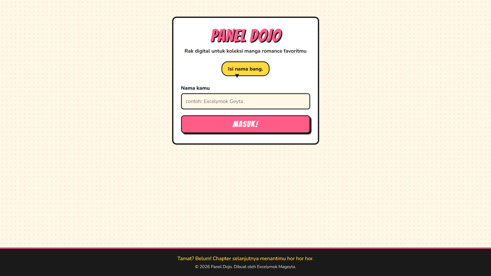
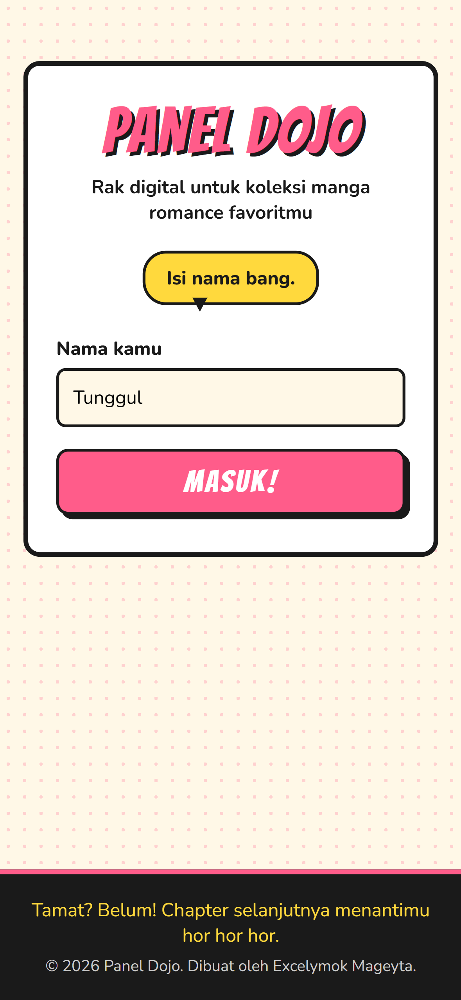
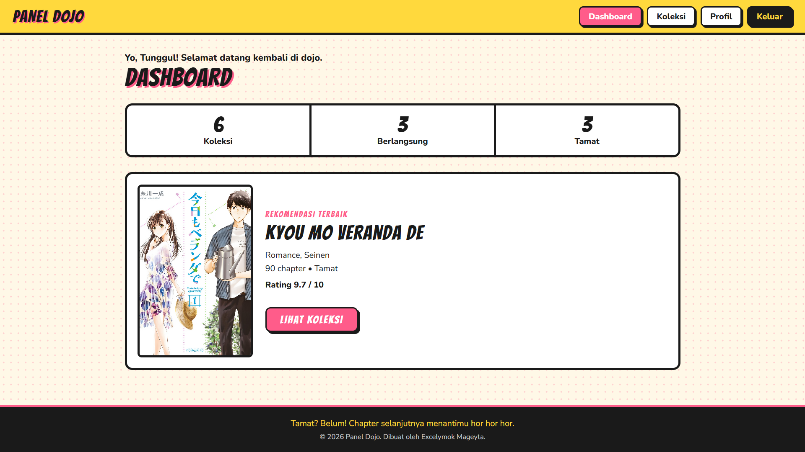
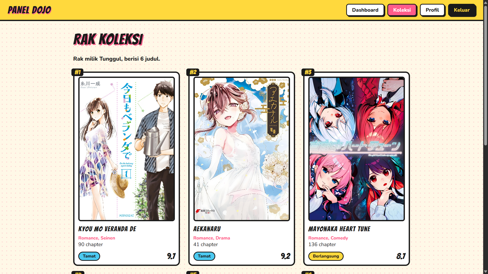
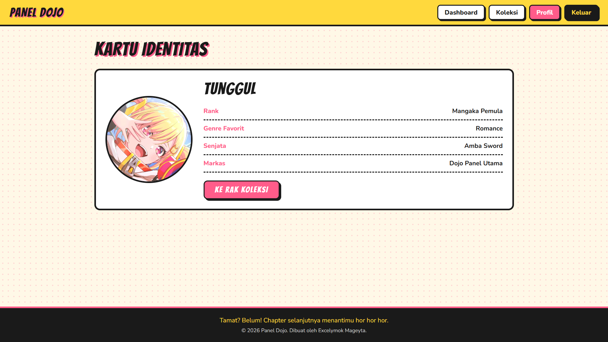
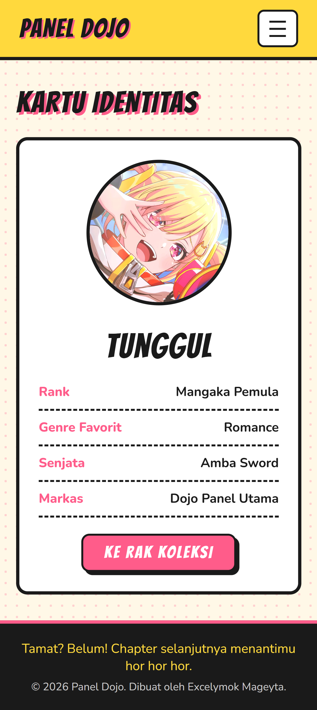

# Panel Dojo

Aplikasi web pengelolaan koleksi manga romance bertema komik Jepang.
Dibuat pake Laravel 11 (MVC murni, Blade, tanpa database) untuk UTS Pemrograman Website.

**Nama:** Gerald Jepedro Sitorus
**NIM:** 252410103052
**Kelas:** D

## Penjelasan Singkat

Panel Dojo adalah rak digital untuk mengelola daftar manga romance. Alurnya:
login pakai nama kalian, lalu masuk ke Dashboard yang isinya ringkasan koleksi, ada halaman Koleksi
yaitu daftar manga dari array di Controller, dan Profil.

Username dikirim dari form login ke halaman lain lewat request parameter (`?username=...`).

## Fitur

- Form login dengan validasi
- Dashboard berisi statistik dan rekomendasi terbaik
- Halaman pengelolaan menampilkan daftar manga pakai @foreach
- Halaman profil
- Tampilan responsif dengan gaya komik Jepun

## Tech Stacknya

- Laravel 11 (Blade, Route, Controller)
- CSS native
- Google Fonts (Bangers, Nunito)

## Screenshot

### Login

### Dashboard

### Koleksi

### Profil

